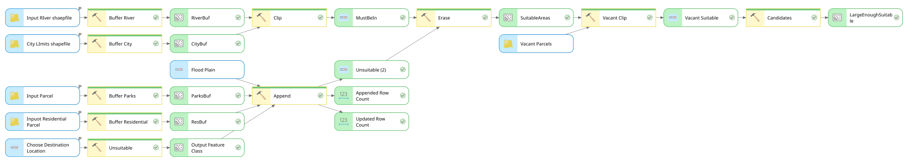

# ArcGIS Pro Site Selection — Fort Collins, CO

A vector-overlay suitability model built in **ArcGIS Pro ModelBuilder** that finds vacant parcels suitable for development based on proximity to the city and a river, while avoiding flood plains, residential areas, and parks.



## Selection criteria

| Criterion | Rule | Tool |
|---|---|---|
| Near the city | Within **1 mile** of city limits | Buffer |
| Near water | Within **300 ft** of a river | Buffer → Clip |
| Not in flood zone | Outside the flood plain | Erase |
| Away from homes | More than **300 ft** from residential parcels | Buffer → Erase |
| Away from parks | More than **300 ft** from parks | Buffer → Erase |
| Available land | Vacant parcels only | Clip |
| Big enough | `Shape_Area > 50000` | Select |

## Workflow

1. **Buffer** residential parcels and parks (300 ft, dissolved).
2. **Create Feature Class + Append** the flood plain and both buffers into one *Unsuitable* layer.
3. **Buffer** city limits (1 mi) and rivers (300 ft), then **Clip** the city buffer to the river buffer → *MustBeIn*.
4. **Erase** the unsuitable areas from *MustBeIn* → *SuitableAreas*.
5. **Clip** vacant parcels to the suitable areas → *Vacant Suitable*.
6. **Select** parcels with `Shape_Area > 50000` → *LargeEnoughSuitable* (final candidates).

## Repository layout

```
├── modelbuilder/
│   └── SiteSelection_export.py   # Original "Export to Python" output from ModelBuilder
├── src/
│   └── site_selection.py         # Cleaned, parameterized, reusable version
├── docs/
│   └── SiteSelection_model.svg   # Exported model diagram
└── README.md
```

## Data inputs

Expected in a file geodatabase (data is **not** included in this repo):

| Layer | Geometry |
|---|---|
| `Hydro` (rivers) | Line |
| `City Limits` | Polygon |
| `Parks` | Polygon |
| `Residential Parcels` | Polygon |
| `Flood Plain` | Polygon |
| `Vacant Parcels` | Polygon |

Coordinate system: NAD 1983 StatePlane Colorado North FIPS 0501 (meters).

## Running it

**Requirements:** ArcGIS Pro 3.x with an active license (`arcpy`).

From the ArcGIS Pro Python window:

```python
import sys; sys.path.append(r"C:\path\to\arcgis-site-selection\src")
import site_selection
site_selection.site_selection(
    river="Hydro", city_limits="City Limits", parks="Parks",
    residential="Residential Parcels", flood_plain="Flood Plain",
    vacant_parcels="Vacant Parcels", out_gdb=r"C:\data\FtCollins.gdb",
    overwrite=True)
```

From the command line using ArcGIS Pro's Python environment:

```bat
"C:\Program Files\ArcGIS\Pro\bin\Python\scripts\propy.bat" src\site_selection.py C:\data\FtCollins.gdb --overwrite
```

### Outputs (written to the geodatabase)

`ResBuf`, `ParksBuf`, `Unsuitable`, `CityBuf`, `RiverBuf`, `MustBeIn`, `SuitableAreas`, `VacantSuitable`, `Candidates` (final result).

## Notes

- **Area units:** `Shape_Area` is measured in the output's coordinate-system units. In the State Plane (meters) projection used here, 50,000 m² ≈ 12.4 acres. If your data uses a US-feet projection, the same threshold means 50,000 ft² ≈ 1.15 acres — adjust `min_area` accordingly.
- **Partial parcels:** because vacant parcels are *clipped* to suitable areas, the area test applies to the suitable portion of each parcel, not the whole parcel.
- **Differences from the ModelBuilder export:** the cleaned script replaces hard-coded paths with parameters, uses *Merge* instead of *Create Feature Class + Append*, exposes buffer distances and the area threshold as arguments, and uses simpler output names.
